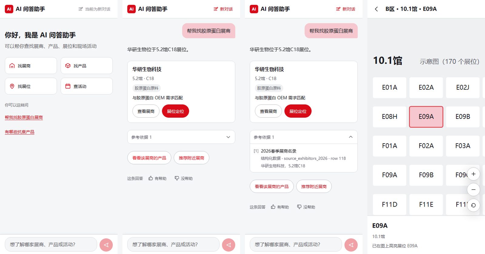

# AI 问答助手（公开展示版）

为一场大型线下展会开发的 AI 问答助手：嵌在主办方微信小程序里的 H5，观众用对话查展商、产品、活动，并在展馆平面图上定位展位。2026 年 9 月展期在线运行，三天。

项目两人分工：**本仓库是我负责的 A 方部分**，包括 H5 前端、BFF 后端、接口契约、模拟知识库服务和全部测试。知识库检索和 AI 回答由 B 方负责，不在这里。



## 做了什么

- **流式对话**：
  - SSE 逐字输出，阶段状态提示，可以停止生成，断网后能恢复；
  - 同一条消息只生成一次回答（Redis 租约实现幂等，进程重启后可回放）；
  - 未知事件安全忽略，上游 503 统一转成用户看得懂的提示。
- **卡片与反馈**：展商 / 产品 / 活动卡片，参考依据默认折叠，推荐追问，点赞点踩；点踩的反馈先进队列，失败了会重试。
- **契约先行**：双方接口写成 JSON Schema，自动生成前后端共用的 TypeScript 类型，契约测试守住格式。接真实 B 方服务时只改 BFF 的上游适配层，H5 组件一行不动。
- **展位地图**：
  - 用 Python 从主办方的矢量 PDF 提取 19 个展馆平面图；
  - A 区的展位号在源文件里是图形轮廓，改用逐格 OCR，可定位展位从 28 个恢复到 830 个，全场 2517 / 2774 个展位能精确高亮；
  - 从聊天卡片或展商详情一键跳到展位，自动缩放居中；
  - 重写了拖动和双指缩放，拖动响应从约 113 ms 降到 1 ms 量级。
- **部署**：Docker Compose + Nginx 多实例，Redis 存会话和限流。

## 线上数据（展期 3 天）

| 指标 | 数值 |
|---|---|
| 前端核心资源请求 | 3781 次，成功率约 99.97% |
| 前端侧故障 | 0 次 |
| 地图打开 | 79 次，独立用户约 31 人 |

系统没有地图埋点。地图页只有真正打开时才会请求对应展馆的图，所以这组数据是展后从 Nginx 访问日志里反推出来的。

## 技术栈

React 19 · Vite · React Router · Fastify 5 · Prisma · PostgreSQL · Redis · SSE · JSON Schema（ajv、json-schema-to-typescript）· pnpm monorepo · Vitest · Testing Library · Playwright · Docker · Nginx · Python（PyMuPDF、OCR）

## 目录

```
apps/h5                 H5 前端（对话、卡片、展位地图）
apps/bff                BFF：会话、流式转发、幂等、反馈队列、限流（Fastify + Prisma + Redis）
apps/mock-b             模拟 B 方知识库服务，联调和测试用
packages/contracts      接口契约（JSON Schema），类型从这里生成
packages/generated-types 生成产物，勿手改
packages/sse            SSE 解析
packages/demo-catalog   演示数据：展馆、展位编号、展商简称
scripts                 Python：从 PDF 提取馆图、OCR 补展位号
tests                   契约测试、端到端测试
deploy                  Dockerfile、docker-compose、Nginx 配置
docs                    设计规格、验收清单与证据、发布回滚与故障追踪手册
```

## 本地跑起来

需要 Node 20+、pnpm 10、Docker。

```bash
pnpm install
pnpm build          # 先编出各个包，BFF 和 H5 才能引用
pnpm typecheck
```

集成测试要用 PostgreSQL 和 Redis：

```bash
docker run -d --name t-pg -e POSTGRES_PASSWORD=assistant_dev_password -e POSTGRES_DB=assistant_dev -p 127.0.0.1:55532:5432 postgres:16-alpine
docker run -d --name t-redis -p 127.0.0.1:56379:6379 redis:7-alpine
pnpm --filter @ai-assistant/bff prisma:migrate:deploy
pnpm test           # 296 项单元 / 集成测试
pnpm test:e2e       # Playwright 端到端测试
```

Windows 上如果 55532 端口被系统保留，换个端口映射，再用 `DATABASE_URL` 环境变量指过去即可，测试会优先读它。

完整的一套服务（含模拟 B 方）用 `deploy/docker-compose.yml` 起，用法写在文件开头。

## 公开版去掉了什么

为了能公开，下面这些没有放进来：

- 主办方的需求文档；
- 生产服务器信息和运维记录；
- 主办方的原版馆图，以及从原图识别出的编号文件和内部补名表。

`apps/h5/public/maps/` 里的馆图，换成了按真实展位编号生成的格子示意图。展位 id 规则和正式版一样，所以定位和高亮照常能用。正式版的馆图处理方法见 [docs/acceptance/hall-maps.md](docs/acceptance/hall-maps.md)。
